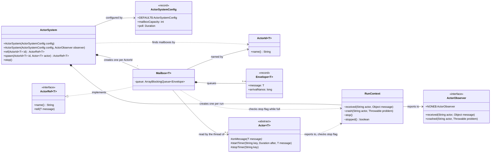
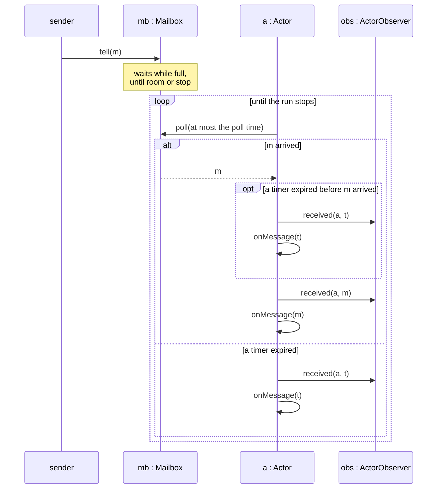
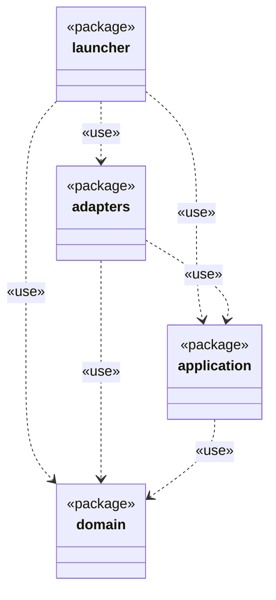

# Single-lane tunnel: specification

> Follows the airlock worked example. Every item has an id (J, A, E, P, T, D, S) cited in the docs, the code (`// Implements: P1`) and the tests (`// Verifies: P1`).

## 1. Context

TODO: what the controller does; its sensors, actuators and users.

## 2. Requirements

### 2.1 Functional requirements

#### Table 1. Users' journeys
| # | Journey |
|---|---|
| J1 | TODO |

#### Table 2. Alternative and exception flows
| # | Flow | What the controller does |
|---|---|---|
| A1 | TODO | TODO |
| E1 | TODO | TODO |

### 2.2 Non-functional requirements: temporal properties

#### Table 3. Temporal properties
| # | Kind | Property | Hazard if violated |
|---|---|---|---|
| P1 | safety | TODO | TODO |
| P2 | bounded response | TODO (state the assumptions and faults under which it holds) | TODO |

### 2.3 Main journey, as the user sees it

TODO: Mermaid sequence diagram (user and system).

### 2.4 Constraints, assumptions and exclusions

Constraints: TODO

Assumptions: TODO

Exclusions: TODO

## 3. Design

### 3.1 Structure

TODO: structural diagram (communication, component or class), message table (Table 4), and how the shared resource is requested, granted and released.

TODO: the event log (D7): an `ActorObserver` (section 3.1.1) that writes
`In` and `Crash` lines in the expected logs' format, with the time in
real-system ms (D8); a message's `toString()` prints it as the expected logs
write it (`Green(A)`, not a record's `Green[end=A]`); an actor logs `Out`
before it sends, so a receiver's `In` never comes before the sender's `Out`;
`launcher` writes the log to the file after `stop()`, in a `finally`, so a
failed run keeps its log.

#### 3.1.1 Actor runtime

Every active object is built on the actor runtime in `application.actor` (D3):
a library on the JDK only that knows nothing of the project, so it can become
a module of its own (D9). It writes no log: it reports what happens to an
observer, and the project decides what to make of it (D13).


**Figure 8.** *UML class diagram of the actor runtime.*

- **`ActorSystem`**: `ref(id)` returns an actor's address, creating its
  mailbox if needed; `spawn(id, actor)` attaches the actor and starts its
  thread, once per id. A message sent before its actor is spawned waits, so
  actors are wired in any order (D11). `stop()` stops and joins every actor,
  and fails if a mailbox was never spawned; `ref` and `spawn` after it are
  refused. One system is one run: it creates the run's `RunContext`, with the
  observer it is given (`ActorObserver.NONE` when none is).
- **`ActorSystemConfig`**: the mailbox capacity and the poll time; `DEFAULT`
  is 16 messages and 2 ms.
- **`ActorObserver`**: what the runtime reports, and the project's one way to
  see inside a run (D13). `received(actor, message)` is called for every
  delivery, an expired timer's included, on the actor's own thread, before
  `onMessage`, in the order the actor handles them. `crashed(actor, problem)`
  is called before the run stops. It is called from every actor's thread, so it
  must be safe to call from several threads at once; an exception it throws is
  a crash of the actor that called it. `NONE` does nothing.
- **`ActorId<T>`**: an actor's typed name, a constant compared by identity
  (a second id with the same name is refused); its name is the one reported.
- **`ActorRef<T>`**: `tell` puts a message in the mailbox, waiting while it is
  full until there is room or the run stops (D11).
- **`Mailbox<T>`**: hidden; the actor's inbox, a `java.util.concurrent.ArrayBlockingQueue` of
  `Envelope`s (message and arrival time), with the configured capacity; each
  message is stamped when it enters.
- **`Actor<T>`**: the base class. Its loop reports each message to the
  observer and calls `onMessage`, one message at a time, until the run stops
  (D10). Named timers: `startTimer(key, ...)` replaces the timer with that key,
  `stopTimer(key)` cancels it; the run waits the delay it is given, which
  `launcher` has already shortened for a faster run (D8); an expired timer's
  message is delivered before the messages that arrived after its deadline
  (D12).
- **`RunContext`**: hidden; what one run's threads share: the stop flag and the
  observer.

Rules for actors and their users:

- Mailboxes are bounded, so no cycle of actors may hold more messages in
  flight than its mailboxes' capacity, and no more than the capacity may be
  sent to an actor before it is spawned; the actors' design argues it (D11).
- An exception from `onMessage` is reported as a crash and stops the run.
- At stop, messages still waiting or in a mailbox are dropped and not
  reported.
- Threads stop by the flag, never by interrupt: an `InterruptedException` only
  ends a wait, restoring the flag.

**Extending it.** An actor extends `Actor<T>` and implements `onMessage`; the
project sees a run through its observer:

```java
static final ActorId<String> ECHO = new ActorId<>("Echo");
static final ActorId<String> SINK = new ActorId<>("Sink");

ActorSystem system = new ActorSystem(ActorSystemConfig.DEFAULT,
    new ActorObserver() {
      @Override public void received(String actor, Object message) {
        System.out.println(actor + " <- " + message);
      }
    });
system.spawn(SINK, new Actor<>() {
  @Override protected void onMessage(String m) {}
});
system.spawn(ECHO, new Actor<>() {
  @Override protected void onMessage(String m) { system.ref(SINK).tell(m); }
});
system.ref(ECHO).tell("hi"); // reports Echo <- hi, then Sink <- hi
```

### 3.2 Main scenario with internal interactions (S1)

TODO: Mermaid sequence diagram with the internal participants.

#### 3.2.1 One message through an actor


**Figure 9.** *UML sequence diagram of an actor's loop. `t` is the message of
the timer due first. A message that arrives during `onMessage` waits in the
mailbox.*

### 3.3 State machines

TODO: one Mermaid state machine per concurrent component, transitions numbered (T1, T2, ...). Say what is ignored and what is latched.

### 3.4 Implementation modules and dependencies

Each module is a Java package under `pt.feup.tacs.tunnel`, named here by its
last part. The packages follow a ports-and-adapters (hexagonal)
architecture (D1): `domain` and `application` are the application
core, which defines its ports; `adapters` plug into them, and `launcher` starts
the application with its configuration. Every dependency points toward the
core. The components that fill the packages are designed in sections 3.1 to
3.3.

A **port** is a one-way, bounded message channel with a single operation, send:
an active object is reached by a port that `launcher` makes from its address in
the actor runtime (D9), and it never knows what is behind the ports it sends
into (D2). The bound belongs to what carries the messages, so a send may wait
while the channel is full.

Figure 7 shows the main packages; Table 5 adds `application`'s subpackages.
Any dependency not allowed there is forbidden, and a test checks it (D5).


**Figure 7.** *UML package diagram of `pt.feup.tacs.tunnel`: a dashed arrow is
a dependency («use»). Packages are drawn as boxes with the «package»
stereotype, as Mermaid has no package shape.*

#### Table 5. Packages
| Package | Purpose | What belongs here | What never goes here | May use |
|---|---|---|---|---|
| `launcher` | launch: starts the application and holds its configuration | the configuration (times, device settings); creating the actor system, spawning the active objects and connecting them through their ports, stopping the run | logic of any kind | everything |
| `adapters` | adapter: everything that plugs into a port | what faces the world: the devices, active objects built on `application.actor` that receive through their inbox and send into the ports they are given at start. Here they are simulated (section 2.4); real drivers would replace them with no change in the core (D6) | controller decisions; any reference to `application`'s components | `domain`, `application.port`, `application.actor` |
| `application` | core: the controller's active objects, one class per concurrent component, including the coordinator that owns the shared resource | a class built on the actor runtime, with its state; it receives a message, passes it to its decision function, and does what was decided through its ports. Thin: no decisions of its own | decisions (they go in `domain`); knowledge of what is behind a port; any reference to an adapter | `domain`, `application.port`, `application.actor` |
| `application.actor` | core: the actor runtime, a self-contained library that knows nothing of the project (D3, D9) | what makes a component an active object (section 3.1.1): mailboxes, the base actor and its loop, its timers, starting and stopping; the stop flag, and the observer it reports deliveries and crashes to (D13). The only package with locks, `synchronized` and thread start and join | any type or decision of the problem; any class of the project's other packages; any log format | nothing (the JDK only) |
| `application.port` | core: the ports, how anything reaches or leaves the core | contracts only: the one-way bounded channel every message travels on (D2), whatever carries it (here the actor runtime; another transport could) | implementations, threads, decisions | nothing |
| `domain` | core: the controller's decisions, as pure logic | message types, states, decision functions (state, message → state, actions), the SPEC's times as named constants (the values used are given by `launcher`, D8): anything reviewable line by line against a state machine (D4) | threads, queues, clock, logging, I/O; anything that waits or has side effects | nothing |

**Where a new component goes.** Decisions in `domain`; the controller's
concurrent components in `application`; things of the world in `adapters`; new
kinds of crossing in `application.port`; thread and queue mechanics in
`application.actor`, and only generic ones (D9).

### 3.5 Summary of design decisions

#### Table 6. Design decisions
| # | Decision | Rationale | Serves |
|---|---|---|---|
| D1 | Ports and adapters (hexagonal): the core (`domain`, `application`) defines its ports, `adapters` plug into them, `launcher` starts the application with its configuration; every dependency points toward the core. | the core is reviewed and tested without knowing what the world is made of | architecture |
| D2 | A port is a one-way, bounded message channel; no request/response methods. | no component calls into another's thread; no queue grows without limit | architecture |
| D3 | One actor runtime, in `application.actor`, for every active object, core and adapters alike, with the stop flag they share; it knows nothing of tunnels, reports deliveries and crashes to an observer (D13), and is the only place with locks and thread handling (section 3.1.1). | concurrency is written and reviewed in one place; the core owns the concurrency model (active objects, inboxes, message loop), adapters only what faces the world | architecture |
| D4 | Decision functions live in `domain`, apart from the threads that run them. | reviewable against the state machines line by line, with no I/O, threads or clock | architecture |
| D5 | A test enforces the dependencies of Figure 7 and Table 5 with ArchUnit (pending the teachers' approval), matching `application` as its own package, not its subpackages. | the agent cannot break the architecture without a failing test | architecture |
| D6 | Devices are adapters, simulated here; the test driver plays the users through them. | real drivers replace them with no change in the core | architecture |
| D7 | Every message, internal ones included, is logged with its time. | the tests check the whole system, the protocol between components included | architecture |
| D8 | Times are parameters, given at start; the controller uses only the real clock. A faster run is given a speed factor: `launcher` divides every time it gives by it, and the event log multiplies its times back, so the log stays in real-system time. The actor runtime knows no speed. | the tests run faster with shorter times, against expected logs in real-system time (tracecheck); times are calibrated without changing the code | architecture |
| D9 | The actor runtime uses only the JDK, no class of the project; `launcher` makes ports from actors' addresses (`ref(id)::tell`). A test enforces it (D5). | ports may be carried by another transport; the runtime can move to its own Maven module | architecture |
| D10 | An actor extends an open base class, `Actor<T>`, and implements `onMessage`; the loop, its reports to the observer and the timers are the runtime's. | one small extension point; what every actor does alike is written once | D3, D7 |
| D11 | An actor's mailbox is created by the first `ref` or `spawn` of its `ActorId`; `tell` waits while it is full, until room or stop; the messages in flight in a cycle of actors are bounded by its design. Timers are the mailbox's wait time; the poll time only bounds how late the stop flag is seen. | actors are wired in any order with one `spawn` each; nothing is lost in a correct design; no second queue, timer thread or interrupt | architecture |
| D12 | Expired timers and waiting messages are handled by arrival time: an expiry goes before the messages that arrived after its deadline. | a busy mailbox cannot hold back a timeout (the worked example's loop could), and a message that came in time is not overtaken by a timeout | D11 |
| D13 | The actor runtime knows no log format: it reports every crash, and every delivery (an expired timer's included, on the actor's thread, before `onMessage`), to one `ActorObserver` per system. The event log is the project's, built on it (section 3.1). | the runtime stays minimal and reusable (D9); D7's "every message" stays in the loop, where no actor can forget it | D3, D7, D9 |
| D14 | TODO: decisions of sections 3.1 to 3.3 about the tunnel | TODO | TODO |
