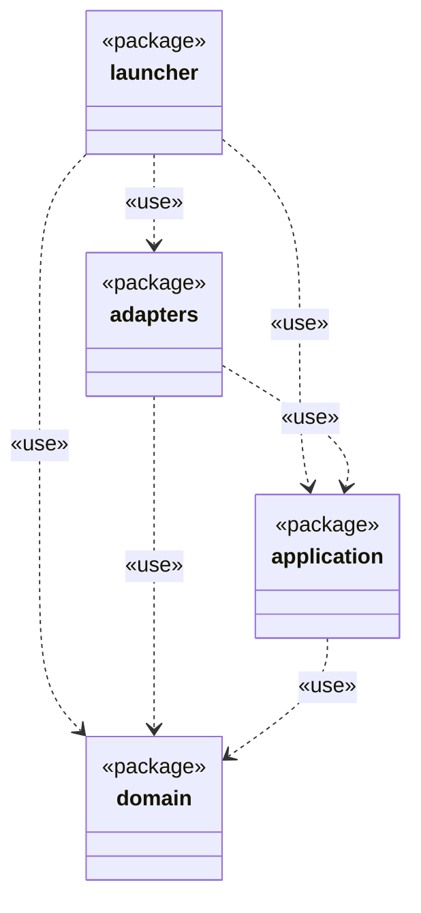

# Single-lane tunnel: specification

> Follows the airlock worked example. Every item has an id (J, A, E, P, T, D, S) cited in the docs, the code (`// Implements: P1`) and the tests (`// Verifies: P1`).

## 1. Context

TODO: what the controller does; its sensors, actuators and users.

## 2. Requirements

### 2.1 Functional requirements

#### Table 1. Users' journeys
| # | Journey |
|---|---|
| J1 | TODO |

#### Table 2. Alternative and exception flows
| # | Flow | What the controller does |
|---|---|---|
| A1 | TODO | TODO |
| E1 | TODO | TODO |

### 2.2 Non-functional requirements: temporal properties

#### Table 3. Temporal properties
| # | Kind | Property | Hazard if violated |
|---|---|---|---|
| P1 | safety | TODO | TODO |
| P2 | bounded response | TODO (state the assumptions and faults under which it holds) | TODO |

### 2.3 Main journey, as the user sees it

TODO: Mermaid sequence diagram (user and system).

### 2.4 Constraints, assumptions and exclusions

Constraints: TODO

Assumptions: TODO

Exclusions: TODO

## 3. Design

### 3.1 Structure

TODO: structural diagram (communication, component or class), message table (Table 4), and how the shared resource is requested, granted and released.

### 3.2 Main scenario with internal interactions (S1)

TODO: Mermaid sequence diagram with the internal participants.

### 3.3 State machines

TODO: one Mermaid state machine per concurrent component, transitions numbered (T1, T2, ...). Say what is ignored and what is latched.

### 3.4 Implementation modules and dependencies

Each module is a Java package under `pt.feup.tacs.tunnel`, named here by its
last part. The packages follow a ports-and-adapters (hexagonal)
architecture (D1): `domain` and `application` are the application
core, which defines its ports; `adapters` plug into them, and `launcher` starts
the application with its configuration. Every dependency points toward the
core. The components that fill the packages are designed in sections 3.1 to
3.3.

A **port** is a one-way, bounded message channel with a single operation, send:
an active object's inbox is the port it is reached by, and it never knows what
is behind the ports it sends into (D2). The bound belongs to what carries
the messages, so a send may wait while the channel is full.

Figure 7 shows the main packages; Table 5 adds `application`'s subpackages.
Any dependency not allowed there is forbidden, and a test checks it (D5).

**Figure 7.** *UML package diagram of `pt.feup.tacs.tunnel`: a dashed arrow is
a dependency («use»). Packages are drawn as boxes with the «package»
stereotype, as Mermaid has no package shape.*

#### Table 5. Packages
| Package | Purpose | What belongs here | What never goes here | May use |
|---|---|---|---|---|
| `launcher` | launch: starts the application and holds its configuration | the configuration (times, device settings); creating the run context and the inboxes, connecting the active objects through their ports, starting and stopping them | logic of any kind | everything |
| `adapters` | adapter: everything that plugs into a port | what faces the world: the devices, active objects built on `application.actor` that receive through their inbox and send into the ports they are given at start. Here they are simulated (section 2.4); real drivers would replace them with no change in the core (D6) | controller decisions; any reference to `application`'s components | `domain`, `application.port`, `application.actor` |
| `application` | core: the controller's active objects, one class per concurrent component, including the coordinator that owns the shared resource | a class that owns a thread, an inbox and its state; it receives a message, passes it to its decision function, and does what was decided through its ports. Thin: no decisions of its own | decisions (they go in `domain`); knowledge of what is behind a port; any reference to an adapter | `domain`, `application.port`, `application.actor` |
| `application.actor` | core: the runtime that makes a component an active object; knows nothing of tunnels (D3) | generic mechanics shared by every active object, in the core or in an adapter: how it receives, calls its decision function, carries out the actions, keeps time and stops; and the run context they share (clock, event log, stop flag). The only package where locks, `synchronized` and thread start and join appear | any type or decision of the problem; anything from `domain` | `application.port` |
| `application.port` | core: the ports, how anything reaches or leaves the core | contracts only: the one-way bounded channel every message travels on (D2) | implementations, threads, decisions | `domain` |
| `domain` | core: the controller's decisions, as pure logic | message types, states, decision functions (state, message → state, actions), the SPEC's times as named constants (the values used are given by `launcher`, D8): anything reviewable line by line against a state machine (D4) | threads, queues, clock, logging, I/O; anything that waits or has side effects | nothing |

**Where a new component goes.** Decisions in `domain`; the controller's
concurrent components in `application`; things of the world in `adapters`; new
kinds of crossing in `application.port`; thread and queue mechanics in
`application.actor`.

### 3.5 Summary of design decisions

#### Table 6. Design decisions
| # | Decision | Rationale | Serves |
|---|---|---|---|
| D1 | Ports and adapters (hexagonal): the core (`domain`, `application`) defines its ports, `adapters` plug into them, `launcher` starts the application with its configuration; every dependency points toward the core. | the core is reviewed and tested without knowing what the world is made of | architecture |
| D2 | A port is a one-way, bounded message channel; no request/response methods. | no component calls into another's thread; no queue grows without limit | architecture |
| D3 | One actor runtime, in `application.actor`, for every active object, core and adapters alike, with the run context they share (clock, event log, stop flag); it knows nothing of tunnels, and is the only place with locks and thread handling. | concurrency is written and reviewed in one place; the core owns the concurrency model (active objects, inboxes, decision loop), adapters only what faces the world | architecture |
| D4 | Decision functions live in `domain`, apart from the threads that run them. | reviewable against the state machines line by line, with no I/O, threads or clock | architecture |
| D5 | A test enforces the dependencies of Figure 7 and Table 5 with ArchUnit (pending the teachers' approval), matching `application` as its own package, not its subpackages. | the agent cannot break the architecture without a failing test | architecture |
| D6 | Devices are adapters, simulated here; the test driver plays the users through them. | real drivers replace them with no change in the core | architecture |
| D7 | Every message, internal ones included, is logged with its time. | the tests check the whole system, the protocol between components included | architecture |
| D8 | Times are parameters, given at start; the controller uses only the real clock. | the tests run faster with shorter times; times are calibrated without changing the code | architecture |
| D9 | TODO: decisions of sections 3.1 to 3.3 | TODO | TODO |
